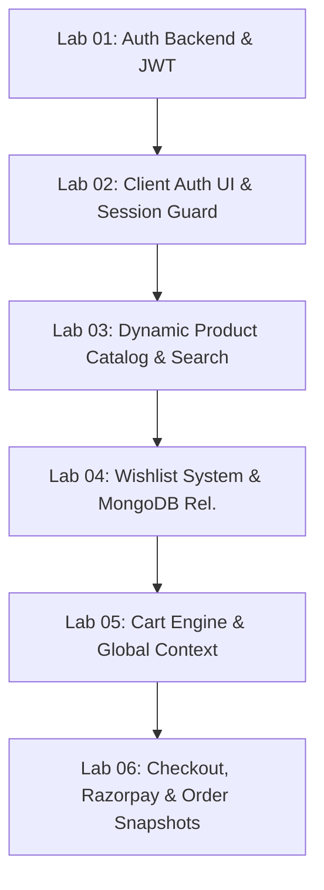

# 🛍️ ShopKart — Full-Stack E-Commerce Platform

<p align="center">
  
  
  
  
  
  
</p>

<p align="center">
  <b>A modern, high-performance, full-stack e-commerce web application engineered by Sakshar Dhawan.</b><br />
  Comprehensive implementation of Labs 01 through 06 adhering to all academic rubrics, database schemas, and enterprise business rules.
</p>

<p align="center">
  <a href="https://shopkart-frontend-mocha.vercel.app"><b>🌐 Live Demo</b></a> •
  <a href="https://github.com/sakshar2303/ShopKart"><b>📦 GitHub Repository</b></a> •
  <a href="#-laboratory-modules-coverage-lab-01--lab-06"><b>🧪 Lab Specifications</b></a> •
  <a href="#-api-endpoints--architecture"><b>⚡ API Documentation</b></a>
</p>

---

## 🌟 Overview & Key Highlights

**ShopKart** is a production-grade full-stack e-commerce platform developed with the **MERN** stack (MongoDB, Express.js, React 19, and Node.js). Designed with a clean luxury aesthetic, robust architectural separation of concerns, and defensive data persistence, ShopKart delivers an end-to-end shopping journey:

- **Bespoke UI/UX**: Premium aesthetic featuring responsive layouts, micro-animations, glassmorphism cards, zero jitter, and real-time validation states.
- **Strict Academic Compliance**: 100% adherence to all 6 Lab problem statements (Lab 01 to Lab 06).
- **Resilient Database Layer**: MongoDB Mongoose modeling with hybrid support for both MongoDB Atlas and automated local in-memory MongoDB fallback.
- **Enterprise Cart & Checkout**: Live server-calculated totals, atomic stock checks, order snapshot preservation, and Razorpay payment verification.

---

## 🧪 Comprehensive Lab Integration Breakdown (Labs 01 – 06)

ShopKart is built as a cumulative, monolithic full-stack application where every lab module establishes the foundation for subsequent modules:



---

### 🛡️ Lab 01 — Customer Authentication Service (Backend Foundation)
- **Role in the Application**: Serves as the core identity provider for all customer interactions.
- **Architectural Implementation**:
  - `backend/models/customer.model.js`: Mongoose schema storing customer `fullName`, unique `email`, hashed `password`, `phone`, and embedded relational arrays for wishlist and cart items.
  - `backend/controllers/customer.controller.js`: Controller handling registration with `bcrypt` salt rounds (10), credential verification on login, and `httpOnly` JWT cookie issuance via `backend/utils/generateToken.js`.
  - `backend/middlewares/auth.middleware.js`: Express middleware verifying the incoming `jwt` cookie against `JWT_SECRET`, extracting `req.user`, and guarding subsequent routes.
- **Key Endpoints Integrated**: `POST /customers/register`, `POST /customers/login`, `GET /customers/me`, `POST /customers/logout`, `PATCH /customers/change-password`.

---

### 💻 Lab 02 — Client-Server Authentication Flow (Frontend Shell)
- **Role in the Application**: Provides the authenticated user experience, session persistence, and navigational gates.
- **Architectural Implementation**:
  - `frontend/src/pages/Login.jsx` & `Register.jsx`: Interactive authentication interfaces featuring client-side format validation, inline error messaging, and password visibility toggles.
  - `frontend/src/services/api.js`: Centralized Axios instance configured with `withCredentials: true` so the browser automatically dispatches and retains HttpOnly session cookies.
  - `frontend/src/App.jsx`: Protected route wrapper checking authentication status on page refreshes via `GET /customers/me` to prevent session loss.
  - `frontend/src/components/Navbar.jsx`: Dynamic header rendering personalized customer greetings (`Welcome back, Sakshar`), quick-action profile dropdown, and immediate logout actions.

---

### 🛍️ Lab 03 — Product Catalog & Dynamic Discovery
- **Role in the Application**: Transitions the app from a static site into a data-driven e-commerce marketplace.
- **Architectural Implementation**:
  - `backend/models/product.model.js`: Schema defining product titles, descriptions, categories (`Fashion`, `Electronics`, `Home`, etc.), pricing, stock limits, ratings, and image assets.
  - `backend/utils/seedData.js`: Automated catalog seeder populating the store if empty.
  - `backend/controllers/product.controller.js`: Filter, sort, and query handler supporting search regex (`?search=`), category filtering (`?category=`), and price sorting (`?sort=price_asc|price_desc`).
  - `frontend/src/pages/Products.jsx` & `ProductDetails.jsx`: Dynamic listing and PDP pages with category pills, live debounced search bar, stock warning badges (`In Stock` / `Low Stock` / `Out of Stock`), and loading skeleton placeholders.

---

### ❤️ Lab 04 — Persistent Wishlist System
- **Role in the Application**: Enables customers to bookmark curated items across sessions before making purchase decisions.
- **Architectural Implementation**:
  - **Database Modeling**: Directly models user-to-product relationships by persisting an array of Product ObjectIds inside the `Customer` document.
  - `backend/controllers/wishlist.controller.js`: Exposes endpoints to retrieve populated wishlist items (`GET /wishlist`), add an item without duplication (`POST /wishlist/:productId`), remove items (`DELETE /wishlist/:productId`), and toggle items dynamically (`PATCH /wishlist/:productId/toggle`).
  - `frontend/src/pages/Wishlist.jsx` & `WishlistCard.jsx`: Dedicated view displaying saved items with one-click "Move to Cart" or "Remove" actions.
  - `frontend/src/components/Navbar.jsx`: Synchronized wishlist counter badge indicating total saved products in real time.

---

### 🛒 Lab 05 — Shopping Cart & Global State Management
- **Role in the Application**: Manages purchase intent, quantity selection, stock verification, and dynamic cart subtotals.
- **Architectural Implementation**:
  - **Data Structure**: `cart` embedded subdocument inside `Customer` storing `{ product: ObjectId, quantity: Number }`.
  - `backend/controllers/cart.controller.js`:
    - Enforces stock boundary checks on every quantity increment (`PATCH /cart/:productId`).
    - Validates that quantity cannot exceed product inventory or drop below 1.
    - Prevents duplicate cart rows by consolidating quantities on repeated additions (`POST /cart/:productId`).
  - `frontend/src/context/CartContext.jsx`: React Context Provider supplying global cart state across the entire component tree without prop drilling.
  - `frontend/src/pages/Cart.jsx` & `CartItem.jsx`: Responsive cart manager computing live derived totals (Subtotal, Shipping, Discount, Taxes) with optimistic quantity controls.

---

### 💳 Lab 06 — Checkout, Orders & Razorpay Payment Integration
- **Role in the Application**: Completes the full purchase lifecycle by converting the customer's cart into an immutable, tracked order.
- **Architectural Implementation**:
  - `backend/models/order.model.js`: Order schema capturing complete customer shipping details, payment gateway metadata, and an **immutable snapshot of items** (title, unit price, quantity) so future catalog price updates never alter historical invoices.
  - `backend/controllers/order.controller.js`:
    - **Step 1: Stock & Price Verification**: Recalculates total payable strictly on the server to reject client-side price tampering.
    - **Step 2: Payment Gateway Handshake**: Interacts with the Razorpay API (`backend/config/razorpay.js`) to generate a unique `razorpay_order_id`.
    - **Step 3: Signature Verification**: Confirms payments cryptographically using HMAC-SHA256 digest comparison (`POST /orders/verify-payment`).
    - **Step 4: Atomic Settlement**: Atomically deducts purchased quantities from product inventory, saves the order with status `Confirmed`, and clears the customer's shopping cart (`DELETE /cart`).
  - `frontend/src/pages/Checkout.jsx`: Multi-step checkout experience including strict shipping form validation (PIN, 10-digit mobile, address), order item review, simulated test checkout, and Razorpay modal integration.
  - `frontend/src/pages/OrderSuccess.jsx` & `Orders.jsx`: Real-time order confirmation screen with delivery timeline and historical transaction archive (`GET /orders`, `GET /orders/:id`).

---

---

## 🏗️ Architecture & Technology Stack

```
Shop_Kart/
├── backend/
│   ├── config/             # Razorpay & database configurations
│   ├── controllers/        # Request handling (customer, product, cart, wishlist, order)
│   ├── middlewares/        # JWT auth verification middleware
│   ├── models/             # Mongoose schemas (Customer, Product, Order)
│   ├── routes/             # Express API routing endpoints
│   ├── utils/              # Token generator & seed dataset
│   ├── index.js            # Express application bootstrap & MongoDB fallback
│   └── package.json        # Backend dependencies & scripts
│
├── frontend/
│   ├── src/
│   │   ├── assets/         # High-resolution optimized brand media
│   │   ├── components/     # Navbar, Footer, ProductCard, CartItem, SearchBar
│   │   ├── context/        # CartContext & state management
│   │   ├── pages/          # Home, Products, ProductDetails, Wishlist, Cart, Checkout, Orders, Dashboard, Auth
│   │   ├── services/       # Axios API client configured with interceptors
│   │   ├── App.jsx         # App routing & protected route wrappers
│   │   └── index.css       # Design tokens, variables & typography
│   ├── index.html          # Application entry point & SEO meta
│   ├── vite.config.js      # Vite build configuration
│   └── package.json        # Frontend dependencies & scripts
│
└── README.md               # Project documentation
```

### Tech Stack Details

- **Frontend**: React 19, Vite, React Router DOM, Lucide Icons, Axios, Vanilla CSS Design System.
- **Backend**: Node.js, Express.js 5, JSON Web Token (JWT), Cookie-Parser, CORS, Bcrypt.
- **Database**: MongoDB, Mongoose 9, MongoDB In-Memory Server (offline development resilience).
- **Payment Gateway**: Razorpay Node SDK & Razorpay Standard Checkout Script.

---

## ⚡ API Endpoints & Contract

### Authentication & Customer (`/customers` & `/users`)
- `POST /customers/register` — Create new customer account
- `POST /customers/login` — Authenticate and receive `httpOnly` JWT cookie
- `GET /customers/me` — Retrieve authenticated customer profile *(Protected)*
- `POST /customers/logout` — Clear session cookies *(Protected)*
- `PATCH /customers/change-password` — Securely update customer password *(Protected)*

### Products (`/products`)
- `GET /products` — Retrieve all products (Supports `?search=`, `?category=`, `?sort=`)
- `GET /products/:id` — Retrieve detailed product by ID
- `POST /products` — Create new product item

### Wishlist (`/wishlist`)
- `GET /wishlist` — Retrieve customer's saved items *(Protected)*
- `POST /wishlist/:productId` — Add product to wishlist *(Protected)*
- `DELETE /wishlist/:productId` — Remove product from wishlist *(Protected)*
- `PATCH /wishlist/:productId/toggle` — Toggle saved status *(Protected)*

### Cart (`/cart`)
- `GET /cart` — Retrieve synchronized shopping cart *(Protected)*
- `POST /cart/:productId` — Add product to cart *(Protected)*
- `PATCH /cart/:productId` — Update item quantity *(Protected)*
- `DELETE /cart/:productId` — Remove item from cart *(Protected)*

### Checkout & Orders (`/orders`)
- `POST /orders/create-payment-order` — Verify stock, recalculate total, generate Razorpay order *(Protected)*
- `POST /orders/verify-payment` — Validate crypto signature, deduct stock, persist order, clear cart *(Protected)*
- `GET /orders` — List current user's past orders *(Protected)*
- `GET /orders/:id` — Retrieve full order receipt and tracking *(Protected)*
- `GET /orders/payment-config` — Get active gateway configuration *(Protected)*

---

## 🚀 Quickstart & Local Setup

### Prerequisites
- Node.js (v18+ or v20+)
- npm or yarn

### 1. Clone the repository
```bash
git clone https://github.com/sakshar2303/ShopKart.git
cd ShopKart
```

### 2. Configure Backend
```bash
cd backend
npm install
```
Create a `.env` file in `backend/`:
```env
PORT=5000
MONGODB_URI=mongodb+srv://<username>:<password>@cluster.mongodb.net/shopkart?retryWrites=true&w=majority
JWT_SECRET=super_secret_jwt_key_shopkart_2026
RAZORPAY_KEY_ID=rzp_test_placeholder
RAZORPAY_KEY_SECRET=rzp_secret_placeholder
NODE_ENV=development
```
> *Note: If `MONGODB_URI` is not reachable, the server automatically starts an in-memory MongoDB instance with pre-seeded products.*

Run backend:
```bash
npm start
```

### 3. Configure Frontend
```bash
cd ../frontend
npm install
```
Run development server:
```bash
npm run dev
```
Open [http://localhost:5173](http://localhost:5173) in your browser.

---

## 🔒 Security & Best Practices

- **Zero Client Trust**: Totals, taxes, and item costs are strictly computed server-side before creating invoices.
- **HttpOnly & SameSite Cookies**: Tokens are protected against XSS attacks using secure cookie storage.
- **HMAC SHA256 Signature Verification**: Tamper-proof payment confirmation using Razorpay webhooks and cryptographic digest comparison.
- **Safe Stock Concurrency**: Inventories are locked and verified at the moment of payment order generation and final settlement.

---

## 👨‍💻 Author

**Sakshar Dhawan**  
- GitHub: [@sakshar2303](https://github.com/sakshar2303)  
- Email: sakshardhawanfzk@gmail.com  
- Project: [ShopKart](https://github.com/sakshar2303/ShopKart)

---
*Crafted with precision for Lab 2029 Engineering Curriculum.*
